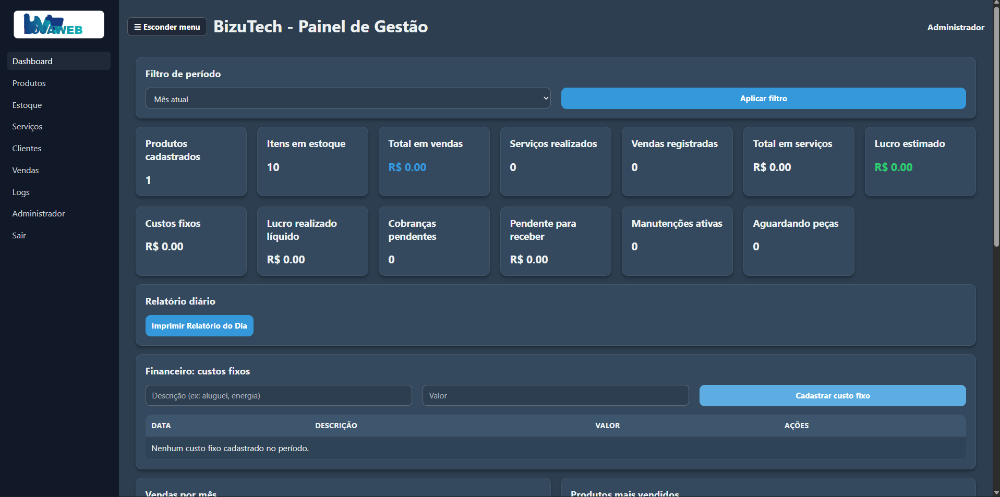
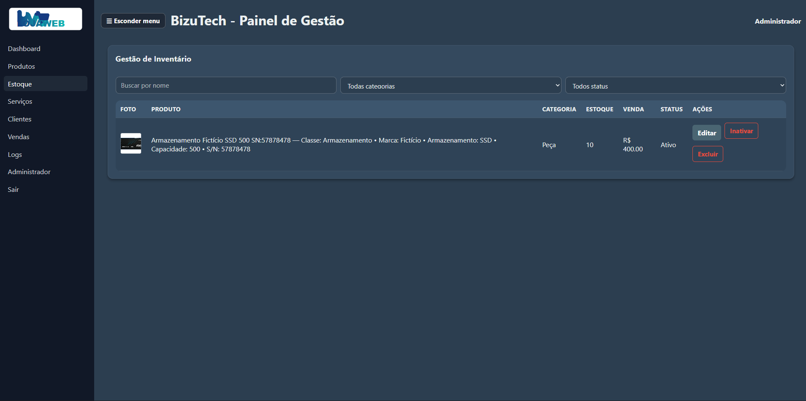
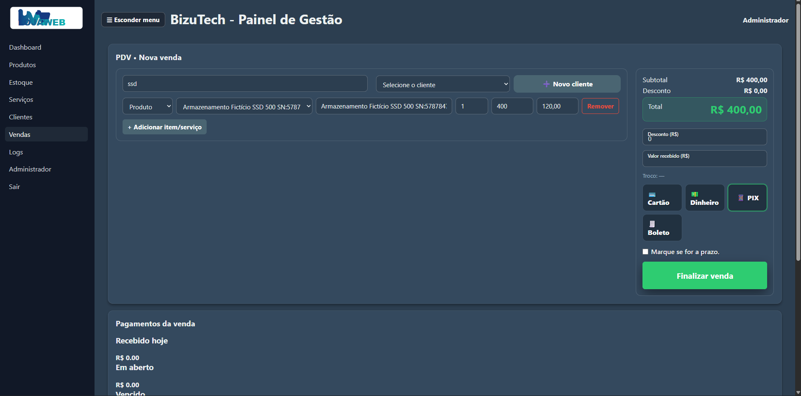
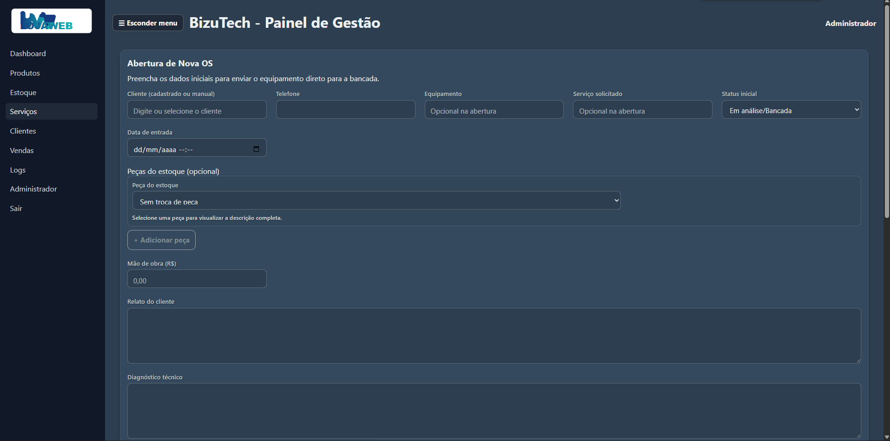

# LojaWeb

O LojaWeb é um sistema web para lojas de informática e assistências técnicas. Reúne cadastro de peças e clientes, controle de estoque, registro de vendas e abertura de ordens de serviço. Desenvolvido em Python com Flask. A demonstração usa SQLite e Docker Compose.



## LojaWeb em uso

### Estoque

Consulte quantidade, preço de venda e status dos produtos. A captura mostra um SSD fictício com 10 unidades em estoque.



### Ponto de venda

Adicione produtos ou serviços, aplique desconto e selecione a forma de pagamento. A captura mostra uma venda em preparação de um SSD por R$ 400,00.



### Ordens de serviço

Abra uma ordem para registrar o equipamento, o relato do cliente e o diagnóstico técnico, com opção de vincular peças do estoque.



## Como rodar a demonstração

Com Docker e Docker Compose disponíveis, abra um terminal na raiz do repositório. Defina `DEFAULT_ADMIN_PASSWORD` com uma senha de teste de pelo menos 12 caracteres e `SECRET_KEY` com uma chave gerada localmente. No Bash, inclusive no GitHub Codespaces:

```bash
read -rs -p 'Senha de teste (mínimo de 12 caracteres): ' DEFAULT_ADMIN_PASSWORD
printf '\n'
export DEFAULT_ADMIN_PASSWORD
export SECRET_KEY="$(openssl rand -hex 32)"
docker compose up
```

- **Localmente**. Abra [http://localhost:5000](http://localhost:5000).
- **No Codespaces**. Na aba **Ports**, encaminhe a porta `5000` como privada e abra a URL gerada.

Entre com `admin@lojaweb.local` e a senha definida no primeiro uso. A demonstração começa com um banco SQLite vazio. A recuperação de senha por e-mail depende de configuração SMTP.
